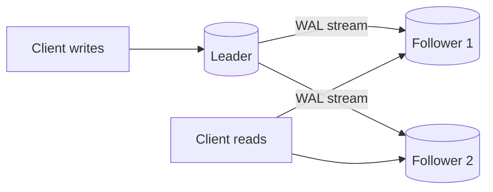
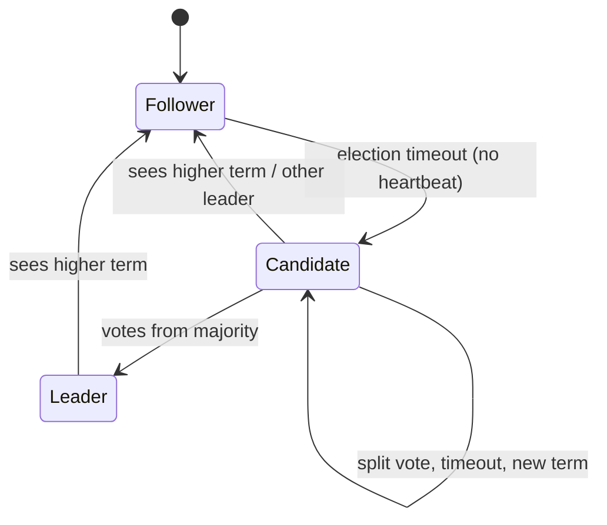
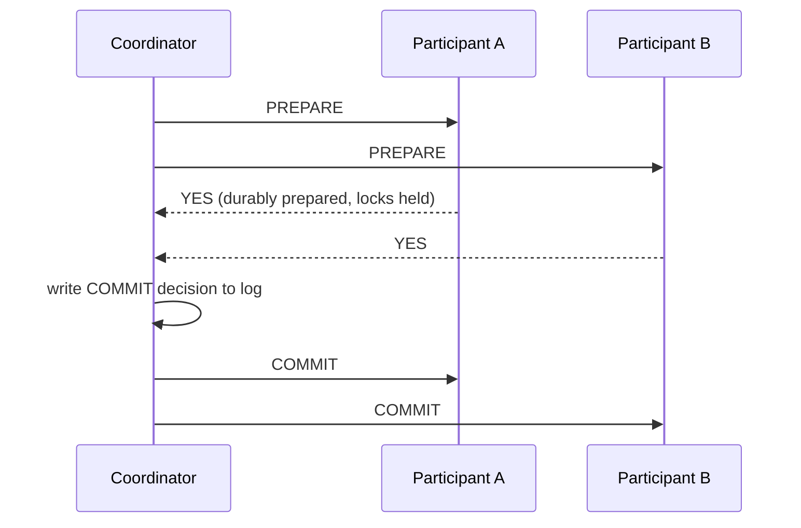
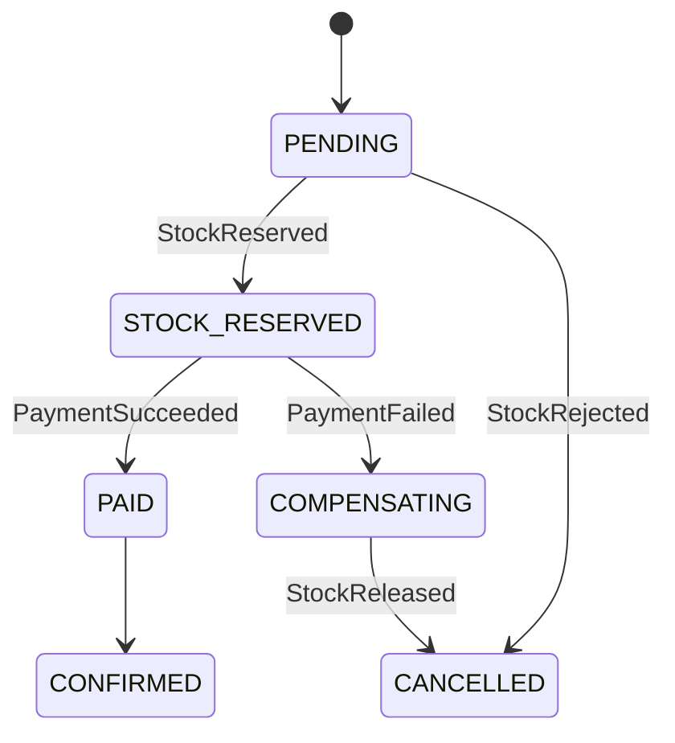
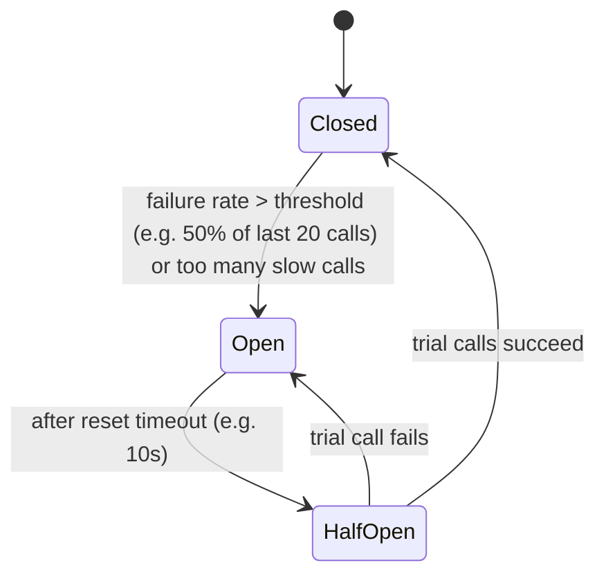

# System Design: Weeks 02–03 Explained

Detailed, interview-oriented explanation of every topic in the curriculum.
Each topic follows the same template:

1. **What it is**: plain explanation
2. **How it works**: the mechanism, with a diagram
3. **Example**: SQL / pseudo-code / Node.js
4. **Trade-offs and when to use it**
5. **Misconceptions and interviewer traps**
6. **Interview Q&A**
7. **Practice**: which step of [`02-implementation-guide.md`](02-implementation-guide.md) exercises it

> The curriculum names **Kafka** for queues. This document covers Kafka in full. The practice system uses **RabbitMQ** (the chosen stack) and points out where RabbitMQ Streams is the closest analog to Kafka.

---

## Table of Contents

**Week 02: Database Core**
- Block 1: Storage and Queries
  - [1. Data Models and Choosing a Database](#1-data-models-and-choosing-a-database)
  - [2. Indexes: B-Tree vs LSM, Why Queries Are Slow](#2-indexes-b-tree-vs-lsm-why-queries-are-slow)
  - [3. Transactions and ACID](#3-transactions-and-acid)
  - [4. Isolation Levels and Anomalies](#4-isolation-levels-and-anomalies)
- Block 2: Distributed Data
  - [5. Replication](#5-replication)
  - [6. Distributed Consensus and Raft](#6-distributed-consensus-and-raft)
  - [7. Sharding and Partitioning](#7-sharding-and-partitioning)
  - [8. CAP and PACELC](#8-cap-and-pacelc)

**Week 03: Cache, Queues and Resilience**
- Block 1: Cache and Queues
  - [9. Caching Strategies and Architecture](#9-caching-strategies-and-architecture)
  - [10. Cache Problems](#10-cache-problems)
  - [11. Queues and Brokers](#11-queues-and-brokers)
- Block 2: Consistency Between Services
  - [12. Idempotency and Transactional Outbox](#12-idempotency-and-transactional-outbox)
  - [13. Distributed Transactions: 2PC, 3PC, Saga](#13-distributed-transactions-2pc-3pc-saga)
- Block 3: Fault Tolerance
  - [14. Retries, Timeouts, Backoff](#14-retries-timeouts-backoff)
  - [15. Circuit Breaker and Bulkhead](#15-circuit-breaker-and-bulkhead)
  - [16. Rate Limiting](#16-rate-limiting)
  - [17. Scaling and Graceful Degradation](#17-scaling-and-graceful-degradation)

[Appendix: Interview Answer Framework](#appendix-interview-answer-framework)

---

# Week 02: Database Core

## Block 1: Storage and Queries

---

## 1. Data Models and Choosing a Database

### What it is
A **data model** is how data is shaped and how you query it. The model you pick decides which queries are cheap, which are expensive, and which are impossible without application code. Choose by **access patterns**, not by hype.

### The main models

| Model | Examples | Shape | Good at | Bad at |
|---|---|---|---|---|
| Relational | PostgreSQL, MySQL | Tables, rows, FK, joins | Ad-hoc queries, joins, strong constraints, transactions | Horizontal write scaling (without extra tooling), very flexible schemas |
| Document | MongoDB, Couchbase, Postgres `jsonb` | Self-contained JSON trees | Loading a whole aggregate in one read, evolving schema | Many-to-many relations, cross-document joins |
| Key-value | Redis, DynamoDB, etcd | `key -> blob` | O(1) lookups at massive scale, caches, sessions, counters | Any query that is not by key |
| Wide-column | Cassandra, ScyllaDB, HBase | Partition key + sorted clustering columns | Huge write throughput, time series, append-heavy data | Ad-hoc queries; you design tables per query |
| Graph | Neo4j, Neptune | Nodes + edges with properties | Multi-hop traversals (friends-of-friends, fraud rings, recommendations) | Bulk aggregates, simple CRUD at scale |
| Search | Elasticsearch, OpenSearch | Inverted index | Full-text, faceting, relevance ranking | Being the source of truth |
| Time-series | TimescaleDB, InfluxDB, ClickHouse | Time-partitioned, columnar | Metrics, aggregates over time ranges | Point updates |

### How to decide: questions to ask

1. **What are the top 3–5 queries?** Read by ID? Range by time? Joins across entities? Traversals?
2. **Read/write ratio and volume.** 100 writes/s fits any DB. 500k writes/s points to LSM-based (Cassandra) or sharding.
3. **Relationships.** One-to-many tree (an order and its items) suits a document. Many-to-many (users ↔ groups ↔ permissions) suits relational. Deep, variable-depth links suit graph.
4. **Consistency needs.** Money and inventory need transactions and constraints, so relational. Likes counter tolerates eventual consistency.
5. **Schema evolution.** Heterogeneous attributes (product catalog with per-category fields) suit documents or `jsonb`.
6. **Operational maturity.** The team knows Postgres? That is a strong argument by itself.

### Example: same domain, different models

An order with items.

Relational:
```sql
CREATE TABLE orders (id uuid PRIMARY KEY, customer_id uuid NOT NULL, status text NOT NULL, created_at timestamptz NOT NULL);
CREATE TABLE order_items (order_id uuid REFERENCES orders(id), sku text, qty int CHECK (qty > 0), price_cents bigint, PRIMARY KEY (order_id, sku));
```

Document:
```json
{ "_id": "o-1", "customerId": "c-7", "status": "PAID",
  "items": [ { "sku": "A1", "qty": 2, "priceCents": 1500 } ] }
```

Key-value (cache of the same order): `order:o-1 -> "<serialized JSON>"`.

Graph (fraud check): `(:Customer)-[:USED_CARD]->(:Card)<-[:USED_CARD]-(:Customer)` finds accounts sharing cards in one traversal. In SQL this is N self-joins.

### Trade-offs
- **Document locality** gives a single read per aggregate, but updating a field duplicated across many documents is painful (denormalization).
- **Relational normalization** gives no duplication and integrity via FK, but needs joins, and joins across shards are expensive.
- **Polyglot persistence** (Postgres for orders, Redis for cache, Elasticsearch for search) is normal. Each extra store costs ops effort and requires a sync mechanism (CDC, outbox).

### Misconceptions and traps
- "NoSQL scales, SQL does not." Postgres handles tens of thousands of TPS on one node. Scaling is about partitioning, which exists for SQL too (Citus, Vitess, CockroachDB, Spanner).
- "NoSQL has no schema." It has a **schema-on-read**: the schema lives in your code instead of the DB.
- "MongoDB has no transactions." It has multi-document ACID transactions since 4.0 (replica sets) and 4.2 (sharded clusters). They cost more than single-document writes, so documents are still modeled to avoid needing them.
- "Pick graph DB because there are relationships." Every domain has relationships. Graph wins only for multi-hop, variable-depth traversals.

### Interview Q&A
- **Q: You are designing a chat. Which DB for messages?** A: Access pattern is "last N messages of a chat, append-heavy". A wide-column store with partition key `chat_id`, clustering key `message_time DESC` (Cassandra; Discord did this, then moved to ScyllaDB, a Cassandra-compatible rewrite in C++, to escape JVM GC pauses and hot-partition pain) fits. Postgres with partitioning works at moderate scale.
- **Q: When would you put JSON into Postgres instead of MongoDB?** A: When most data is relational and only part is schemaless (product attributes). `jsonb` + GIN index gives flexibility without a second store.
- **Q: Why not store everything in Redis?** A: Memory cost, limited durability guarantees (AOF/RDB can lose recent writes), no secondary indexes or ad-hoc queries.

**Practice:** Step 3 of the implementation guide.

---

## 2. Indexes: B-Tree vs LSM, Why Queries Are Slow

### What it is
An **index** is an additional data structure that lets the DB find rows without scanning the entire table. It speeds up reads and slows down writes (every insert/update must update every index).

### B-Tree (PostgreSQL, MySQL InnoDB, most relational DBs)

```
                    [ 50 | 100 ]                 <- root page
                   /     |      \
        [10|20|30]   [60|70|80]   [120|150]      <- internal pages
          / | | \      ...          ...
      leaf pages (sorted keys -> row pointers / rows), linked left-to-right
```

- Balanced tree of fixed-size **pages** (8 KB in Postgres, 16 KB in InnoDB). Depth is usually 3–4 even for billions of rows, so a lookup is 3–4 page reads.
- Leaves are sorted and linked, so **range scans** (`BETWEEN`, `ORDER BY`, `>`) are efficient.
- Updates are **in place**: find the page, modify it, write it back. A Write-Ahead Log (WAL) guarantees durability. Page splits happen when a page is full.
- InnoDB: the primary key index is **clustered** (leaves contain the row itself). Secondary indexes store the PK, so a lookup through a secondary index is two tree descents.
- Postgres: tables are **heaps**. All indexes point to a tuple location (`ctid`). MVCC keeps old row versions in the heap, which is why `VACUUM` is needed.

### LSM-Tree (Cassandra, RocksDB, LevelDB, ScyllaDB, HBase)

```
write -> WAL (append) + MemTable (sorted, in memory)
                 | when full, flush
                 v
         L0: SSTable SSTable SSTable   (immutable sorted files)
                 | compaction (merge-sort, drop overwritten/deleted)
                 v
         L1: SSTable ...  L2: ...      (bigger, non-overlapping key ranges)

read -> MemTable -> (Bloom filter per SSTable) -> SSTables newest to oldest
```

- Writes are **sequential appends**, so write throughput is very high.
- Data is immutable; updates and deletes are new entries (deletes are **tombstones**).
- **Compaction** merges files in the background. Strategies: size-tiered (write-optimized) and leveled (read-optimized).
- Reads may check several files. **Bloom filters** answer "key definitely not here" to skip files.

### The three amplifications (the key to comparing them)

| | B-Tree | LSM |
|---|---|---|
| Write amplification | Whole page written for a small change, plus WAL | Data rewritten many times by compaction |
| Read amplification | Low, predictable (tree depth) | Higher: several levels/files, mitigated by Bloom filters |
| Space amplification | Fragmentation, half-empty pages | Obsolete versions until compaction |
| Typical sweet spot | Read-heavy, OLTP, range queries, predictable latency | Write-heavy, ingestion, time series |
| Latency risk | Page splits, vacuum | Compaction stalls cause p99 spikes |

### Index types you must know (Postgres)
- **B-Tree**: default. Equality and ranges.
- **Hash**: equality only.
- **GIN**: inverted index for `jsonb`, arrays, full-text.
- **GiST / SP-GiST**: geometry, ranges, nearest-neighbor.
- **BRIN**: tiny "min/max per block range" index for naturally ordered huge tables (append-only logs by time).
- **Partial index**: `CREATE INDEX ... WHERE status = 'PENDING'`, small and hot.
- **Expression index**: `CREATE INDEX ON users (lower(email))`.
- **Covering index**: `CREATE INDEX ... (customer_id, created_at) INCLUDE (total_cents)` enables **index-only scans**.

### Composite indexes and the leftmost-prefix rule
Index on `(customer_id, status, created_at)` is sorted first by `customer_id`, then `status`, then `created_at`.

| Query `WHERE` | Uses index? |
|---|---|
| `customer_id = ?` | Yes |
| `customer_id = ? AND status = ?` | Yes |
| `customer_id = ? AND status = ? ORDER BY created_at DESC LIMIT 20` | Yes, including sort (ideal) |
| `status = ?` | Classically no. Postgres 18+, MySQL 8.0.13+ and Oracle can do a **skip scan**: one index probe per distinct `customer_id`. Worth it only when the leading column has few distinct values |
| `customer_id = ? AND created_at > ?` | Partially: seeks by `customer_id`, then filters `created_at` across all statuses |

**Rule of thumb for column order:** equality columns first, then the range/sort column. Among equality columns, order by how queries use them, not blindly by selectivity.

### Why a query is slow: a checklist that is hard to catch you on

1. **No suitable index** gives a `Seq Scan` on a big table.
2. **Wrong column order** in a composite index (leftmost prefix violated).
3. **Function or expression on the column**: `WHERE date(created_at) = '2026-01-01'` or `WHERE lower(email) = ?` cannot use a plain index. Rewrite as a range or add an expression index.
4. **Implicit type cast**: comparing `varchar` column to a number, or a `uuid` with `text`, may disable the index.
5. **Leading wildcard**: `LIKE '%abc'` cannot use a B-Tree (use trigram GIN).
6. **`OR` across different columns** may defeat a single index (planner may use BitmapOr, or rewrite as `UNION`).
7. **Low selectivity**: `WHERE status = 'ACTIVE'` when 90% of rows are active. The planner correctly prefers a seq scan, because random I/O for 90% of rows is worse than sequential reading.
8. **Stale statistics**: planner estimates 10 rows, gets 10 million, chooses nested loop. Fix: `ANALYZE`, raise statistics target, extended statistics for correlated columns.
9. **Bloat**: dead tuples from MVCC; table/index is 10x its live size. Fix: autovacuum tuning, `REINDEX`, `pg_repack`.
10. **Not index-only**: index finds rows but heap fetches dominate (visibility map not set, missing `INCLUDE` columns).
11. **Deep `OFFSET` pagination**: `OFFSET 1000000` still reads and discards a million rows. Use **keyset pagination**: `WHERE (created_at, id) < ($1, $2) ORDER BY created_at DESC, id DESC LIMIT 20`.
12. **N+1 queries** from an ORM: 1 query for the list + N queries for children. Not slow SQL; slow app.
13. **Lock waits**: the query is fast, but waits on a row lock or an `ALTER TABLE` lock. Check `pg_locks` / `pg_stat_activity`.
14. **Too many indexes** slow down writes; each insert updates all of them.
15. **Resource limits**: `work_mem` too small, so sorts/hashes spill to disk ("external merge" in the plan); cold cache; IO saturation.

### Reading `EXPLAIN ANALYZE`

```sql
EXPLAIN (ANALYZE, BUFFERS)
SELECT id, total_cents FROM orders
WHERE customer_id = '7a...' ORDER BY created_at DESC LIMIT 20;
```
```
Limit  (cost=0.56..45.10 rows=20 width=24) (actual time=0.031..0.090 rows=20 loops=1)
  ->  Index Scan using idx_orders_customer_created on orders
        (actual time=0.030..0.085 rows=20 loops=1)
        Index Cond: (customer_id = '7a...'::uuid)
        Buffers: shared hit=24
Planning Time: 0.120 ms
Execution Time: 0.110 ms
```
What to look at:
- **Node type**: `Seq Scan`, `Index Scan`, `Index Only Scan`, `Bitmap Heap Scan`, `Nested Loop`, `Hash Join`, `Sort`.
- **Estimated `rows` vs actual `rows`**: a big mismatch means bad statistics and likely a bad plan.
- **`loops`**: actual time is per loop. A nested loop running 100k times multiplies the cost.
- **`Buffers: shared hit/read`**: `read` means disk/OS cache, `hit` means Postgres buffer cache.
- **`Rows Removed by Filter`**: large number means the index is not selective enough for the predicate.
- **`Sort Method: external merge Disk`**: sort spilled to disk.

### Misconceptions and traps
- "An index always speeds things up." Not for low selectivity, and it slows writes.
- "Index on each column separately is the same as a composite." No; the DB can combine them via bitmap, but a composite is far better for combined predicates and sort.
- "LSM is faster than B-Tree." Faster for writes, usually slower and less predictable for reads.
- "Primary key order does not matter." In InnoDB random UUIDv4 PK causes page splits and fragmentation (the table *is* the PK index). In Postgres the heap is unaffected, but the PK B-Tree still gets random inserts across all leaf pages (poor cache locality, more WAL). Prefer sequential IDs or UUIDv7 (`uuidv7()` is built into Postgres 18).

### Interview Q&A
- **Q: Query uses an index but is still slow. Why?** A: Many heap fetches (low selectivity, not covering), bloat, wrong index chosen due to stale stats, lock waits, or it returns a huge result.
- **Q: Why does Cassandra write faster than Postgres?** A: LSM: appends to commit log + memtable, no read-before-write, no in-place page updates.
- **Q: How do you add an index to a 500 GB production table?** A: `CREATE INDEX CONCURRENTLY` (no long write lock), monitor, check it is `VALID` afterwards.

**Practice:** Step 4.

---

## 3. Transactions and ACID

### What it is
A **transaction** groups several reads/writes into one logical unit: all of it happens, or none of it does, and concurrent transactions are isolated from each other to a defined degree.

### What each letter really guarantees

| Letter | Real meaning | What it is NOT |
|---|---|---|
| **Atomicity** | All-or-nothing on failure. If the transaction aborts (error, crash), all its writes are rolled back. It is really "abortability". | Not about concurrency. |
| **Consistency** | The application's invariants hold before and after (balance ≥ 0, every order has a customer). The DB helps via constraints (`CHECK`, `FK`, `UNIQUE`), but correctness of the logic is the **application's** job. | Not the "C" from CAP (that is linearizability). |
| **Isolation** | Concurrent transactions do not interfere, **to the degree of the configured isolation level**. Full isolation = serializable. | Not "serializable by default". Postgres defaults to Read Committed. |
| **Durability** | Once committed, data survives a crash. Implemented via WAL + `fsync`. In replicated systems often also means "written to N replicas". | Not protection from disk loss without replication/backups. Not guaranteed if `fsync=off` or `synchronous_commit=off`. |

### How it works (Postgres, simplified)
- **WAL (Write-Ahead Log)**: changes are first appended to the log and flushed. Data pages are written later. After a crash, redo from WAL.
- **MVCC**: each row version has `xmin` (creating transaction) and `xmax` (deleting transaction). A reader sees versions visible to its **snapshot**. Readers do not block writers and writers do not block readers.
- **Locks**: writers take row locks; two writers to the same row serialize (the second waits).

### Example: money transfer

```sql
BEGIN;
UPDATE accounts SET balance = balance - 100 WHERE id = 'A' AND balance >= 100;
-- check affected rows == 1 in app, otherwise ROLLBACK (insufficient funds)
UPDATE accounts SET balance = balance + 100 WHERE id = 'B';
INSERT INTO ledger(from_id, to_id, amount) VALUES ('A','B',100);
COMMIT;
```
Crash between the updates gives nothing applied (atomicity). `balance >= 100` in the `WHERE` makes the check-and-update a single atomic statement.

Node.js (TypeORM):
```ts
await dataSource.transaction(async (manager) => {
  const res = await manager.query(
    `UPDATE accounts SET balance = balance - $1 WHERE id = $2 AND balance >= $1`, [100, 'A']);
  if (res[1] !== 1) throw new Error('INSUFFICIENT_FUNDS'); // rollback
  await manager.query(`UPDATE accounts SET balance = balance + $1 WHERE id = $2`, [100, 'B']);
});
```

### What developers wrongly assume
1. **"Inside a transaction I am safe from races."** At Read Committed, read-then-write (`SELECT balance` then `UPDATE balance = <computed>`) still has **lost updates**. Use atomic updates, `SELECT ... FOR UPDATE`, or a higher isolation level.
2. **"`@Transactional` / ORM transaction covers my HTTP call / message publish."** External side effects are not rolled back. Sending an email or a Kafka/RabbitMQ message inside the transaction gives a dual-write problem (see Outbox).
3. **"Commit returned OK so the data is safe on the replica."** With async replication, failover can lose recently committed transactions.
4. **"Each statement in my script is one transaction."** With autocommit, yes, each statement separately. Multi-statement logic needs explicit `BEGIN`.
5. **"Long transactions are harmless."** They hold locks, block `VACUUM` (bloat), and in Postgres keep old snapshots alive.
6. **"A timeout means the transaction failed."** Client timeout ≠ server rollback. The commit may have happened. Hence idempotency.
7. **"Constraints are optional, the app checks."** Two concurrent app checks both pass. Only a `UNIQUE` constraint truly prevents duplicates.

### Trade-offs
Stronger guarantees mean more locking/aborts and less throughput. Keep transactions **short**, no network calls inside, touch rows in a consistent order to avoid deadlocks.

### Interview Q&A
- **Q: What does "C" in ACID mean, and how is it different from "C" in CAP?** A: ACID-C = app invariants preserved. CAP-C = linearizability (every read sees the latest write, as if one copy).
- **Q: How does the DB guarantee durability?** A: WAL flushed with `fsync` before acknowledging commit; plus synchronous replication if node loss must be survived.
- **Q: What is a deadlock and how to avoid it?** A: Two transactions wait for each other's locks. DB detects and aborts one. Avoid by locking in a consistent order, short transactions, and retrying on deadlock error (`40P01`).

**Practice:** Step 5.

---

## 4. Isolation Levels and Anomalies

### Anomalies (from weakest to subtle)

| Anomaly | What happens | Example |
|---|---|---|
| **Dirty write** | T2 overwrites T1's uncommitted write | Two buyers overwrite each other's half-written order |
| **Dirty read** | T2 reads T1's uncommitted data; T1 rolls back | Report shows money that was never transferred |
| **Non-repeatable read** (fuzzy read) | T1 reads a row twice; T2 committed an update in between; values differ | Balance check returns 100, then 50 in the same transaction |
| **Read skew** | T1 sees part of the database before and part after T2's commit | Transfer A→B: T1 reads A (before), then B (after); total looks off by 100 |
| **Lost update** | Two transactions read-modify-write the same row; one overwrites the other | Two counters `x = x_read + 1` both write 11 instead of 12 |
| **Phantom read** | T1 re-runs a range query; T2 inserted/deleted a matching row | `COUNT(*) WHERE room=1 AND time overlap` changes |
| **Write skew** | Two transactions read the same set, make decisions, write **different** rows; together they break an invariant | Two on-call doctors both go off duty, each saw "another doctor is on call" |

### Write skew in detail (favourite interview question)

Invariant: at least one doctor on call.
```
T1: SELECT count(*) FROM doctors WHERE on_call = true;   -- 2
T2: SELECT count(*) FROM doctors WHERE on_call = true;   -- 2
T1: UPDATE doctors SET on_call = false WHERE name = 'Alice'; COMMIT;
T2: UPDATE doctors SET on_call = false WHERE name = 'Bob';   COMMIT;
-- now 0 doctors on call
```
No row was written twice, so row locks never conflict. Snapshot Isolation (Postgres Repeatable Read) **allows** this. Fixes:
- `SERIALIZABLE` (Postgres SSI detects the read-write dependency and aborts one transaction with `40001`).
- Explicitly lock the rows you read: `SELECT ... FOR UPDATE` on the set of on-call doctors.
- Materialize the conflict: a row representing the constraint (e.g. a `shift` row) that both must lock/update.
- Same pattern: meeting room double booking, username uniqueness without a unique index, spending more than balance from two accounts.

### Isolation levels (SQL standard vs reality)

| Level | Dirty read | Non-repeatable | Phantom | Lost update | Write skew |
|---|---|---|---|---|---|
| Read Uncommitted | possible (Postgres treats as RC) | possible | possible | possible | possible |
| Read Committed (Postgres default, Oracle default) | no | possible | possible | possible* | possible |
| Repeatable Read (MySQL default) | no | no | Postgres: no; MySQL: mostly prevented by gap locks for locking reads | Postgres: no (aborts with `40001`); MySQL: **possible** for plain reads | possible |
| Serializable | no | no | no | no | no |

\* Atomic `UPDATE x = x + 1` is safe at Read Committed because the update re-reads the latest committed row version. Read in app then write back is not safe.

### Implementations
- **Postgres**: MVCC. Read Committed takes a new snapshot **per statement**. Repeatable Read = **Snapshot Isolation**, one snapshot per transaction, first-updater-wins on concurrent updates of the same row. Serializable = **SSI** (Serializable Snapshot Isolation): optimistic, tracks read/write dependencies, aborts on dangerous structures. Requires the app to **retry** on `40001 serialization_failure`.
- **MySQL InnoDB**: MVCC for consistent (non-locking) reads + **next-key / gap locks** for locking reads (`FOR UPDATE`, updates). Serializable turns plain `SELECT`s into `SELECT ... LOCK IN SHARE MODE`.
- **Oracle**: "Serializable" is actually snapshot isolation. Write skew is possible.

### Tools to prevent races at a lower level
- **Atomic statements**: `UPDATE stock SET qty = qty - 1 WHERE sku = $1 AND qty >= 1`.
- **Pessimistic locking**: `SELECT ... FOR UPDATE` (wait), `FOR UPDATE NOWAIT` (fail fast), `FOR UPDATE SKIP LOCKED` (job queues).
- **Optimistic locking**: version column.
  ```sql
  UPDATE products SET qty = $newQty, version = version + 1
  WHERE id = $id AND version = $readVersion;   -- 0 rows -> someone else won, retry
  ```
- **Constraints**: `UNIQUE`, `EXCLUDE USING gist (room WITH =, during WITH &&)` prevents overlapping bookings at DB level.
- **Advisory locks**: `pg_advisory_xact_lock(hash)` for app-defined critical sections.

### Choosing the isolation level for the task

| Task | Choice |
|---|---|
| Typical CRUD, single-row updates | Read Committed + atomic updates / optimistic locking |
| Report needing a consistent snapshot across many tables | Repeatable Read (read-only) |
| Complex invariants across multiple rows (booking, on-call, limits) | Serializable + retry loop, or explicit `FOR UPDATE` / constraint |
| High-contention counter | Atomic `UPDATE ... SET x = x + 1` or sharded counters |
| Job queue | Read Committed + `FOR UPDATE SKIP LOCKED` |

### Misconceptions and traps
- "Repeatable Read prevents all anomalies except phantoms" (from the SQL standard table). In Postgres it prevents phantoms but allows write skew; in MySQL it allows lost updates on plain reads.
- "Serializable means transactions run one by one." No: it means the **result** equals some serial order. Implementations run concurrently (SSI, 2PL).
- "Serializable is too slow to use." SSI overhead is often acceptable; the real cost is abort rate under contention and the need for retries.

### Interview Q&A
- **Q: Two users book the last seat simultaneously. How do you prevent overselling?** A: Atomic conditional update (`WHERE seats_left > 0`) and check affected rows; or `FOR UPDATE` on the seat row; or a unique constraint on `(flight, seat_no)`.
- **Q: What is the difference between non-repeatable read and phantom?** A: Non-repeatable: an existing row's value changed. Phantom: the **set** of rows matching a predicate changed.
- **Q: How do you handle `40001` errors?** A: Retry the whole transaction (from `BEGIN`), with a cap and jitter. The transaction must not have external side effects.

**Practice:** Step 5.

---

## Block 2: Distributed Data

---

## 5. Replication

### What it is
Keeping copies of the same data on multiple nodes. Goals: **high availability** (survive node loss), **read scaling**, **lower latency** (copies near users), **durability**.

### Single-leader (primary/replica)



- All writes go to the leader, which streams its log (WAL / binlog) to followers.
- **Synchronous**: leader waits for follower ack before confirming commit. No data loss on leader failure, but a slow/dead follower blocks writes.
- **Asynchronous**: leader confirms immediately. Fast, but committed writes may be lost on failover.
- **Semi-synchronous**: wait for **one** of N followers (Postgres `synchronous_standby_names = 'ANY 1 (r1, r2)'`). Common practical compromise.

**Replication lag consequences** (eventual consistency on followers):
- **Read-your-writes**: user updates profile, reloads, sees old data (read went to a lagging replica). Fix: read from leader for X seconds after a write, or for the user's own data; or track the write's LSN and wait until replica has replayed it.
- **Monotonic reads**: user sees a comment, refreshes, comment disappears (second read hit a more-lagging replica). Fix: sticky routing of a user to the same replica.
- **Consistent prefix reads**: an answer appears before the question (partitioned systems). Fix: causally related writes to the same partition.

**Failover**: detect leader dead (timeout), choose the most up-to-date follower, reconfigure clients. Dangers:
- Lost writes with async replication.
- **Split brain**: two nodes believe they are leader and both accept writes. Prevented with consensus (Patroni + etcd), **fencing** (STONITH, fencing tokens), quorum.
- Timeout too short gives needless failovers under load; too long gives longer downtime.

### Multi-leader
Several nodes accept writes (e.g. one per data center), replicate to each other asynchronously. Good for multi-region writes and offline clients (calendar apps, CRDT-based collaborative editing). Main problem: **write conflicts**. Resolution: last-write-wins (loses data), merge functions, **CRDTs**, or app-level resolution. Avoid unless needed.

### Leaderless (Dynamo-style: Cassandra, Riak, DynamoDB internals)
- Client (or coordinator) sends writes to all N replicas, waits for **W** acks; reads from **R** replicas and takes the newest version.
- **Quorum condition: W + R > N** ensures read and write sets overlap. Typical: N=3, W=2, R=2.
- Repair mechanisms: **read repair** (fix stale replica on read), **anti-entropy** (background Merkle-tree comparison), **hinted handoff** (another node keeps writes for a down node and replays them later).
- **Sloppy quorum**: during a partition, accept writes on "any N healthy nodes", not the designated ones. Better availability, but W+R>N no longer guarantees reading the latest.
- Even with strict quorums, you do **not** get linearizability (concurrent writes, failed partial writes, clock-based LWW).
- Conflict detection: version vectors; Cassandra uses last-write-wins timestamps (clock skew can drop writes).

### How not to lose data when a node dies
1. Synchronous or semi-sync replication to at least one other node (ideally another AZ).
2. Automatic failover via a consensus-based manager (Patroni/etcd, Orchestrator, cloud-managed).
3. Fencing of the old leader.
4. Backups + WAL archiving for point-in-time recovery (replication also replicates `DROP TABLE`; it is not a backup).
5. Monitoring replication lag and alerting.
6. Test failover regularly.

### Interview Q&A
- **Q: User does not see their own comment after posting. Why, and fix?** A: Read served by lagging async replica. Read-your-writes: route the author's reads to the leader for a short window or wait for LSN.
- **Q: N=3, W=1, R=1. What do you get?** A: Max availability/latency, but stale reads likely. W+R=2 is not > 3.
- **Q: Is replication a backup?** A: No. Logical errors (bad `DELETE`) replicate instantly.

**Practice:** Step 6.

---

## 6. Distributed Consensus and Raft

### What it is
**Consensus**: several nodes agree on a single value (or an ordered log of values) even when some nodes fail, and never change it once decided. Uses: leader election, distributed locks, cluster membership, configuration (etcd for Kubernetes, ZooKeeper for older Kafka, Consul), replicated state machines (CockroachDB, TiKV, Kafka KRaft).

Without consensus you get split brain: two leaders, diverging data.

### Raft in plain terms
Raft was designed to be understandable. It splits the problem into **leader election**, **log replication**, and **safety**.

Node states: **Follower**, **Candidate**, **Leader**. Time is divided into **terms** (monotonic numbers). Each term has at most one leader.



**Leader election**
1. Followers expect heartbeats (`AppendEntries`, possibly empty) from the leader.
2. If none arrives within a **randomized election timeout** (e.g. 150–300 ms), the follower increments the term, becomes candidate, votes for itself, sends `RequestVote` to all.
3. A node grants at most one vote per term, and only to a candidate whose log is **at least as up-to-date** as its own (election restriction).
4. Majority of votes gives leadership. Randomization makes split votes rare.

**Log replication**
1. Client sends command to leader. Leader appends to its log.
2. Leader sends `AppendEntries` to followers.
3. Once a **majority** has stored the entry, it is **committed**; leader applies it to its state machine and replies to the client.
4. Followers learn the commit index in later heartbeats and apply.
5. Consistency check: each `AppendEntries` contains the previous entry's index+term; a follower rejects mismatches and the leader backs up until logs match, then overwrites the follower's conflicting suffix.

**Safety**
- A committed entry is on a majority. Any future leader needs votes from a majority. Two majorities overlap, and the election restriction ensures the new leader has all committed entries.
- A cluster of **2f+1** nodes tolerates **f** failures: 3 nodes tolerate 1, 5 tolerate 2. Even sizes add no tolerance (4 nodes still tolerate 1).
- The minority side of a partition cannot elect a leader or commit, so it becomes unavailable for writes (CP behavior).

**Practical details**
- Old leader on minority side may still think it is leader. It cannot commit (no majority). Linearizable reads must confirm leadership (read index / lease) or go through the log.
- Membership changes use joint consensus or single-server changes.
- Logs are compacted with snapshots.

### Raft vs Paxos (high level)
Paxos (Lamport) is the classic; Multi-Paxos is needed for logs and is notoriously hard to implement fully. Raft gives equivalent guarantees with a strong leader and clearer structure. ZooKeeper uses ZAB, a similar protocol.

### Misconceptions and traps
- "Consensus makes the system always available." No: without a majority it stops (by design).
- "More nodes = faster." More nodes = more fault tolerance, slower writes (bigger majority, more network).
- "Use Raft for everything." Use an existing service (etcd, ZooKeeper, Consul) or a DB built on it; do not implement it in business code.
- FLP impossibility: in a fully asynchronous system no deterministic algorithm guarantees consensus termination with even one failure. Raft circumvents it with timeouts (partial synchrony): safety always, liveness when the network behaves.

### Interview Q&A
- **Q: Why an odd number of nodes?** A: 2f+1 tolerates f; adding one to make it even increases quorum size without increasing tolerance.
- **Q: How does Raft prevent two leaders?** A: One vote per node per term, majority required, terms are monotonic; a stale leader steps down when it sees a higher term.
- **Q: What is a fencing token?** A: Monotonic number issued with a lease/lock; storage rejects writes with an older token, so a paused old leader cannot corrupt data.

**Practice:** Step 8 (etcd cluster experiment).

---

## 7. Sharding and Partitioning

### Terms
- **Partitioning**: splitting a dataset into parts. Can be within one node (Postgres declarative partitioning) for manageability and pruning.
- **Sharding**: partitions placed on **different nodes** to scale storage and write throughput beyond one machine.
- Usually combined with replication: each shard is a replica set.

### Strategies

| Strategy | How | Pros | Cons |
|---|---|---|---|
| **Range** | Key ranges (`A–F`, `G–M`), or time ranges | Efficient range scans; easy to drop old data | Hot spots (all new writes go to the latest time range) |
| **Hash** | `hash(key) mod N` | Even distribution | Range queries scatter to all shards; `mod N` remaps almost everything when N changes |
| **Consistent hashing** | Keys and nodes on a hash ring; key goes to next node clockwise; virtual nodes | Adding a node moves only ~1/N of keys | More complex; still no range scans |
| **Fixed number of partitions** | Create e.g. 1024 partitions upfront, map partitions to nodes | Rebalancing = moving whole partitions (Elasticsearch, Kafka, Riak, Couchbase) | Choose count carefully upfront |
| **Directory / lookup** | Service stores `key -> shard` | Maximum flexibility, per-tenant placement | Extra lookup, directory is critical component |
| **Geo / tenant** | By region or tenant ID | Data locality, compliance | Uneven tenant sizes |

### Choosing a shard key
- High cardinality and even distribution.
- Matches the dominant access pattern so most queries hit **one** shard (e.g. `customer_id` for "my orders").
- Avoid monotonically increasing keys with range sharding (timestamps, auto-increment).
- Think about what will become cross-shard: global uniqueness, joins, transactions, aggregations.

### Problems
- **Hot keys / celebrities**: one key gets disproportionate traffic. Fix: split the key (`key#0..key#9` salting), cache, dedicated shard.
- **Secondary indexes**:
  - **Local (document-partitioned)**: each shard indexes its own data. Writes are cheap; queries by the secondary key are **scatter-gather** to all shards.
  - **Global (term-partitioned)**: index itself partitioned by the indexed term. Reads hit one index shard; writes become distributed (often async).
- **Cross-shard transactions** need 2PC or sagas. Design to avoid them.
- **Rebalancing**: move data with minimal disruption; avoid automatic rebalancing triggered by transient failure (cascades).
- **Routing**: client-side library, proxy (Vitess VTGate, mongos), or coordinator node.
- **Resharding** a live system is hard: double writes, backfill, verification, cutover.

### Postgres specifics
```sql
CREATE TABLE orders (id uuid, customer_id uuid, created_at timestamptz NOT NULL, ...)
  PARTITION BY RANGE (created_at);
CREATE TABLE orders_2026_10 PARTITION OF orders
  FOR VALUES FROM ('2026-10-01') TO ('2026-11-01');
```
- **Partition pruning**: query with `created_at` range only scans relevant partitions.
- Drop old data instantly: `DROP TABLE orders_2025_01` instead of a huge `DELETE`.
- Primary key / unique constraints must include the partition key.
- Real sharding across nodes: Citus, or application-level routing, or switch to distributed SQL (CockroachDB, YugabyteDB).

### Consistent hashing sketch (Node.js)
```ts
import { createHash } from 'crypto';
const h = (s: string) => parseInt(createHash('md5').update(s).digest('hex').slice(0, 8), 16);

class Ring {
  private ring: { point: number; node: string }[] = [];
  constructor(nodes: string[], vnodes = 100) {
    for (const n of nodes) for (let i = 0; i < vnodes; i++) this.ring.push({ point: h(`${n}#${i}`), node: n });
    this.ring.sort((a, b) => a.point - b.point);
  }
  get(key: string): string {
    const p = h(key);
    const e = this.ring.find((x) => x.point >= p) ?? this.ring[0];
    return e.node;
  }
}
```

### Interview Q&A
- **Q: Why not `hash(key) % N`?** A: Changing N remaps ~all keys, forcing massive data movement. Use consistent hashing or fixed partitions.
- **Q: Twitter timeline, shard by what?** A: Tweets by `user_id` (author); timelines precomputed per follower (fan-out on write), celebrities handled with fan-out on read.
- **Q: Partitioning vs sharding?** A: Partitioning splits data; sharding = partitions distributed across nodes.

**Practice:** Step 7.

---

## 8. CAP and PACELC

### CAP: the correct statement
In a distributed system, when a **network partition** happens (some nodes cannot talk to others), each operation must choose between:
- **Consistency (C)**: here this means **linearizability**: every read sees the most recent completed write, the system behaves like a single copy.
- **Availability (A)**: every request to a **non-failed** node gets a (non-error) response.

Partitions are not optional in real networks, so **"choose 2 of 3" is wrong**. The real choice is: **during a partition, CP or AP**.

```
            Partition happens
            /               \
      refuse/err (CP)    answer possibly stale (AP)
   e.g. minority side   e.g. both sides accept writes,
   of Raft cluster      reconcile later
```

### Common wrong quotes
- "Our system is CA." Only possible on a single node or if partitions are impossible. A single Postgres node is not "CA distributed DB"; it is simply not distributed.
- "MongoDB is CP, Cassandra is AP" as absolute facts. Both are **tunable** (write concern / read concern; consistency level `QUORUM` vs `ONE`). Properties apply per operation and configuration.
- "Eventual consistency = no consistency." It is a guarantee: replicas converge if writes stop.
- "CAP availability" is strict (every non-failed node responds). Practical "high availability" (99.99%) is a different, weaker notion.
- CAP says nothing about latency, which matters most of the time. Hence PACELC.

### PACELC
**If Partition**: choose **A** or **C**; **Else** (normal operation): choose **L**atency or **C**onsistency.

Even without failures, strong consistency costs latency (synchronous replication, quorum round-trips, cross-region consensus).

| System | P: A or C | E: L or C | Note |
|---|---|---|---|
| DynamoDB (default), Cassandra, Riak | PA | EL | Tunable towards consistency per request |
| MongoDB (majority write/read concern) | PC | EC | Defaults vary by version; tunable |
| PostgreSQL with async replicas | Single leader: writes unavailable on minority side until failover | EL for replica reads (stale), EC for leader reads | Depends on read routing |
| Google Spanner, CockroachDB | PC | EC | Consensus per range; TrueTime/HLC |
| etcd, ZooKeeper | PC | EC | Consensus |
| Redis Sentinel/Cluster (async) | Effectively PA (may lose acked writes on failover) | EL | |

### Practical application in architecture
- Classify **each operation**, not the whole system: payment balance = CP; product view counter = AP; shopping cart = AP with merge.
- Ask: "What happens to this feature if region A cannot reach region B?" Return error, serve stale, or accept writes and reconcile?
- Use consistency models between linearizable and eventual: **causal**, **read-your-writes**, **monotonic reads**, **bounded staleness**.

### Interview Q&A
- **Q: Explain CAP in one sentence.** A: When the network partitions, a replicated system must either reject some requests (stay consistent) or answer them possibly stale (stay available).
- **Q: Why PACELC?** A: Partitions are rare; latency vs consistency is the everyday trade-off.
- **Q: Design a bank balance service, CP or AP?** A: Balance mutations CP (reject rather than overdraft); showing the balance can tolerate brief staleness.

**Practice:** Step 8 (classify demo components).

---

# Week 03: Cache, Queues and Resilience

## Block 1: Cache and Queues

---

## 9. Caching Strategies and Architecture

### What it is
A cache stores results of expensive operations (DB query, computation, remote call) in a faster medium (memory, closer to user) so repeat requests are cheaper. A cache trades **freshness and complexity** for **latency and load reduction**.

### Where caches live (outside in)

```
Browser cache -> CDN (edge) -> Reverse proxy (nginx/Varnish) -> App in-process (LRU map)
 -> Distributed cache (Redis/Memcached) -> DB buffer pool / OS page cache -> Disk
```

| Layer | Caches | Notes |
|---|---|---|
| Client / browser | Static assets, API responses with `Cache-Control`, `ETag` | Cheapest; hard to invalidate (use versioned URLs) |
| CDN | Static content, public cacheable API responses | Global latency; purge APIs |
| Reverse proxy | Whole HTTP responses | Micro-caching (1 s) absorbs bursts |
| In-process | Hot config, small lookups | Fastest (no network); each instance has its own copy, so inconsistent across instances; memory per pod |
| Distributed (Redis) | Objects, sessions, computed results, rate-limit counters | Shared across instances; network hop ~0.2–1 ms |
| DB internal | Pages, plans | Automatic; size `shared_buffers` properly |

### Read/write strategies

**Cache-aside (lazy loading)**: most common.
```ts
async function getOrder(id: string) {
  const cached = await redis.get(`order:${id}`);
  if (cached) return JSON.parse(cached);           // hit
  const order = await db.findOrder(id);            // miss
  if (order) await redis.set(`order:${id}`, JSON.stringify(order), 'EX', 300);
  return order;
}
// on update: write DB, then DELETE cache key (not SET)
```
Pros: only requested data is cached; cache failure does not break reads. Cons: first request is slow; staleness window; race conditions (see next topic).

**Read-through**: the cache library/provider loads from DB on miss (app talks only to cache). Same semantics as cache-aside, logic centralized.

**Write-through**: write to cache and DB synchronously. Cache always warm and fresh for written keys; write latency higher; caches data that may never be read.

**Write-behind (write-back)**: write to cache, flush to DB asynchronously in batches. Very fast writes, absorbs bursts (counters, analytics). Risk of data loss if cache dies before flush; complex ordering.

**Refresh-ahead**: refresh popular keys before they expire. Avoids miss latency for hot keys; wastes work on keys that would not be read.

**Write-around**: writes go only to DB; cache populated on read. Good when written data is rarely read soon.

### Eviction
- **LRU**: evict least recently used. Default choice.
- **LFU**: evict least frequently used; better for stable popularity.
- **TTL**: time-based expiry; bounds staleness.
- Redis `maxmemory-policy`: `allkeys-lru`, `allkeys-lfu`, `volatile-ttl`, `noeviction` (writes fail when full).

### What a cache really speeds up (and what it does not)
- Helps: **read-heavy** data with **high reuse** (skewed popularity, Zipf), expensive computations, slow remote dependencies.
- Hit ratio matters: at 50% hit ratio, DB still gets half the load and p99 is still DB latency.
- Does **not** help: write-heavy workloads, unique queries (long tail), data requiring strict freshness (balances), a slow query that runs once.
- Danger: the system becomes **dependent** on the cache. If cache is cold or down, DB gets 10x load and dies. Capacity-plan the DB for cache-miss scenarios or have protection (see stampede).
- Before caching, check: is the query slow because of a missing index? Fix that first.

### Interview Q&A
- **Q: Cache-aside: on update, delete or set the key?** A: Delete. Setting can race and write an older value; deleting forces a fresh read. Order: update DB, then delete cache.
- **Q: In-process vs Redis?** A: In-process: fastest, but N copies and invalidation across pods is hard. Redis: shared, one network hop. Often both (L1 in-process with short TTL, L2 Redis).
- **Q: What would you cache in an e-commerce site?** A: Product pages (CDN + Redis), catalog/categories, sessions, rate-limit counters. Not: inventory counts at checkout, prices at payment (re-read from source of truth).

**Practice:** Step 9.

---

## 10. Cache Problems

### 1. Invalidation and stale data
"There are only two hard things in Computer Science: cache invalidation and naming things."

Approaches:
- **TTL only**: simple, bounded staleness. Pick TTL by business tolerance.
- **Explicit invalidation on write**: delete keys after DB commit.
- **Event-driven invalidation**: services publish `OrderUpdated`, cache consumers delete keys; or CDC (Debezium) from DB log. Handles writes from other services.
- **Versioned keys**: `product:42:v17`; bump version on write; old keys expire naturally.

**The classic race (cache-aside, delete on write):**
```
t1  Reader: cache miss, reads DB -> value v1
t2  Writer: updates DB to v2
t3  Writer: deletes cache key
t4  Reader: SETs cache = v1   <- stale until TTL
```
Mitigations: short TTL as safety net; **delayed double delete** (delete, then delete again after ~replication lag + read time); set-if-version-newer (store version with value, Lua compare); lease tokens (Facebook memcache "leases": a reader gets a token on miss; a delete invalidates the token so the late SET is rejected).

**Other staleness sources**: reading from a lagging replica to populate cache (caches stale data for full TTL). Populate from the leader after writes.

**Update-cache-then-DB** is wrong: DB write may fail, cache has a value that never existed.

### 2. Cache stampede (thundering herd, dogpile)
A hot key expires; 10,000 concurrent requests miss simultaneously and all hit the DB with the same expensive query.

Fixes:
- **Mutex / lock on miss**: only one request recomputes; others wait briefly or serve stale.
  ```ts
  const token = randomUUID();
  const lock = await redis.set(`lock:${key}`, token, 'PX', 5000, 'NX');
  if (lock) { /* recompute, SET value, release lock only if it still holds our token */ }
  else      { /* sleep 50ms and re-read, or return stale */ }
  ```
  Release with a compare-and-delete Lua script (`if GET == token then DEL`). A plain `DEL` may delete a lock that another instance acquired after ours expired (recompute took longer than the TTL).
- **Request coalescing / single-flight**: within a process, concurrent misses for the same key share one in-flight promise.
- **Stale-while-revalidate**: store a soft TTL inside the value and a longer hard TTL on the key; after soft expiry, serve stale and refresh in the background.
- **Probabilistic early expiration (XFetch)**: each reader recomputes early with a probability that rises as expiry approaches, so typically one request refreshes before the key expires.
- **Pre-warming** caches on deploy.

### 3. Cache avalanche
Many keys expire **at the same time** (all set with TTL 3600 at startup) or the cache cluster restarts; DB is flooded.
Fixes: **TTL jitter** (`3600 + random(0..300)`), staggered warm-up, high-availability cache (replication, Redis Cluster), circuit breaker + rate limit in front of DB.

### 4. Cache penetration
Requests for keys that **do not exist** (in cache or DB), e.g. attacker requests random IDs. Every request goes to DB.
Fixes: **negative caching** (`order:999 -> NULL` with short TTL), **Bloom filter** of existing IDs in front, input validation, rate limiting.

### 5. Hot key
One key receives huge traffic (celebrity profile, flash sale item); a single Redis shard melts.
Fixes: local in-process L1 cache with very short TTL; replicate key under several names (`key#1..#N`) and read randomly; read replicas.

### 6. Big keys
A multi-megabyte value or a list with millions of elements blocks Redis (single-threaded command execution) and saturates network. Split, compress, paginate.

### 7. Consistency between cache and DB transactions
Delete cache **after** commit, not inside the transaction (otherwise a reader may re-populate with old data before commit). Better: invalidation via outbox/CDC so it is not lost if the process crashes between commit and delete.

### Interviewer traps
- "Why delete and not update the cache on write?" (race, wasted work for unread keys).
- "Your TTL is 1 hour. Product price changed. What does the user see?" (Up to 1 h stale unless explicit invalidation.)
- "Redis went down. What happens?" (All traffic to DB. Is the DB sized for it? Circuit breaker? Fallback?)
- "How do you warm up a cold cache after deploy?"
- "Is it OK to cache data read from a replica?" (Risk of caching stale data for a full TTL.)

### Interview Q&A
- **Q: Difference between stampede, avalanche, penetration?** A: Stampede: one hot key expires, many concurrent misses. Avalanche: many keys expire at once or cache dies. Penetration: requests for nonexistent keys bypass cache.
- **Q: How do you keep cache consistent across microservices?** A: Owner service publishes change events (outbox); consumers invalidate. Plus TTL as safety net.

**Practice:** Step 9.

---

## 11. Queues and Brokers

### Why asynchronous messaging
- **Decoupling**: producer does not need consumer online.
- **Load leveling**: absorb bursts; consumers process at their own pace.
- **Fan-out**: one event, many consumers.
- **Reliability**: retries without blocking the user request.
- Cost: eventual consistency, harder debugging, duplicates, ordering issues, more infrastructure.

### Message Queue vs Event Stream

| | Message queue (RabbitMQ, SQS, ActiveMQ) | Event stream / log (Kafka, Kinesis, Pulsar, RabbitMQ Streams) |
|---|---|---|
| Model | Message is a **task** delivered to one consumer; deleted after ack | Event is a **fact** appended to a log; retained for a time/size |
| Consumption | Competing consumers, broker tracks per-message state | Consumers track their own **offset**; many groups read independently |
| Replay | No (once acked, gone) | Yes, reset offset and reprocess history |
| Ordering | Per queue, broken by multiple consumers and redelivery | Guaranteed **per partition** |
| Routing | Rich (exchanges: direct, topic, fanout, headers) | By topic + partition key |
| Per-message features | Priorities, TTL, delayed messages, DLQ, per-message ack | Batch-oriented, simple, very high throughput |
| Scale | Tens of thousands msg/s per node (more with quorum queues/streams) | Millions msg/s per cluster |
| Typical use | Job/task queues, RPC-ish async commands, work distribution | Event sourcing, CDC, analytics pipelines, many independent subscribers, audit log |

### RabbitMQ essentials
```
Producer -> Exchange --(binding key / routing key)--> Queue -> Consumer
```
- **Exchange types**: `direct` (exact routing key), `topic` (`order.*.created` patterns), `fanout` (broadcast), `headers`.
- **Acks**: consumer acks after processing; unacked messages are redelivered if consumer dies. `nack` with `requeue=false` sends to **DLX** (dead letter exchange).
- **Prefetch (QoS)**: max unacked messages per consumer; controls fairness and memory.
- **Publisher confirms**: broker acks to the producer when the message is safely stored. Without them, a publish can be silently lost.
- **Durability**: durable queue + persistent message + **quorum queues** (Raft-replicated) for HA.
- **Retry with delay**: retry queue with `x-message-ttl` dead-lettering back to the main queue (via the default exchange with `x-dead-letter-routing-key=<main queue>`), or the delayed-message plugin.
- **Dead-letter routing key**: a dead-lettered message keeps its original routing key unless the queue sets `x-dead-letter-routing-key`, so bind the DLQ accordingly.
- **Poison message protection**: quorum queues support `x-delivery-limit`. After N redeliveries (e.g. the consumer crashes on the message every time) the message is dead-lettered instead of looping forever.
- **Streams** (`x-queue-type=stream`): an append-only, replicated log with retention and offset-based reading, the closest RabbitMQ analog to a Kafka topic.

### Kafka essentials
```
Topic "orders" = partitions P0, P1, P2 (each an append-only log, replicated)
Producer: partition = hash(key) % partitions  -> all events of one order_id in one partition (ordered)
Consumer group "billing": each partition assigned to exactly one consumer in the group
Consumer group "analytics": independently reads the same partitions with its own offsets
```
- **Partitions** = unit of parallelism and ordering. Consumers in a group ≤ partitions (extra consumers idle).
- **Offsets** committed by consumers; committing **after** processing gives at-least-once.
- **Replication**: leader + ISR (in-sync replicas). `acks=all` + `min.insync.replicas=2` for durability.
- **Retention**: by time/size, or **log compaction** (keep latest per key; good for state/CDC).
- **Idempotent producer** (dedups retries per partition) and **transactions** (atomic writes across partitions + offsets) give exactly-once **within Kafka** (read-process-write).
- Rebalancing on consumer join/leave pauses consumption (cooperative rebalancing reduces this).
- Consensus/metadata: ZooKeeper historically; **KRaft** (Raft-based controller quorum) since 3.3 for production, and Kafka **4.0 (2025) removed ZooKeeper mode entirely**.
- **Queues for Kafka (KIP-932, share groups)**: consumers in a *share group* cooperatively consume the same partitions with **per-message acknowledgement** and redelivery, so more consumers than partitions can work in parallel (queue semantics on top of the log). Early access in 4.0, preview in 4.1; check your Kafka version's docs for production readiness before relying on it.

### Delivery semantics
- **At-most-once**: ack/commit before processing. May lose messages, never duplicates.
- **At-least-once**: ack after processing. Never loses, may duplicate (crash after processing, before ack). **The practical default.**
- **Exactly-once**: end-to-end it is really "at-least-once delivery + idempotent processing" (dedup by message ID, idempotent writes, or transactional offset commit with the output in the same store).

### Ordering
- Global ordering kills parallelism. Need ordering **per entity** (per `order_id`): Kafka partition key; RabbitMQ single active consumer or consistent-hash exchange.
- Retries and DLQs break ordering. Handle via version numbers on events and ignoring older versions.

### Sync vs async: how to decide

| Use sync (HTTP/gRPC) | Use async (queue/stream) |
|---|---|
| User needs the result now (login, price check, "is this in stock") | Work can complete later (email, invoice PDF, analytics, search indexing) |
| Simple request/response with low latency | Spiky load to level out |
| Strong consistency needed in the request | Multiple consumers interested in the same event |
| Few hops | Long-running workflows, retries without blocking user |

Common pattern: accept sync (`202 Accepted` + order ID), process async, notify via webhook/websocket/polling.

### Misconceptions and traps
- "Kafka is a queue." It is a log; classic consumer groups commit an **offset per partition**, not per-message acks, and have no per-message delay or priority. Newer Kafka adds share groups (KIP-932) with per-message acks, but the storage model is still a retained log.
- "Exactly-once delivery exists." Not end-to-end across arbitrary systems; you build idempotency.
- "Async makes the system faster." It reduces the user-facing latency of the request; total work and end-to-end latency may increase.
- "Adding consumers always scales Kafka consumption." With classic consumer groups, only up to the number of partitions (share groups lift this, at the cost of per-partition ordering).
- "The consumers are fine, nothing is failing." Watch **consumer lag** (Kafka: log-end offset − committed offset per partition; RabbitMQ: queue depth and consumer utilization). Growing lag means consumers are slower than producers, and every event is processed later and later.
- Poison messages: a message that always fails blocks the queue (or partition) forever unless you route to DLQ after N attempts.

### Interview Q&A
- **Q: RabbitMQ or Kafka for sending order confirmation emails?** A: RabbitMQ (task queue, per-message retries, DLQ). Kafka if you also need replay or many consumers of `OrderPlaced`.
- **Q: How do you guarantee per-order ordering in Kafka?** A: Use `order_id` as message key, so all events land in one partition; one consumer per partition in a group.
- **Q: Consumer processed the message, then crashed before committing. What happens?** A: Redelivery; duplicate processing. Consumer must be idempotent.

**Practice:** Step 10.

---

## Block 2: Consistency Between Services

---

## 12. Idempotency and Transactional Outbox

### Idempotency
An operation is **idempotent** if performing it multiple times has the same effect as once. Networks force retries (timeouts are ambiguous: did the server do it?), so every non-idempotent side effect (charge card, send money, create order) needs idempotency.

- Naturally idempotent: `SET status = 'PAID'`, `PUT /resource/42`, `DELETE`.
- Not idempotent: `balance = balance - 100`, `POST /payments`, `INSERT` without unique key.

**Idempotency key pattern** (Stripe-style):
1. Client generates a unique key (UUID) per logical operation and sends `Idempotency-Key: <uuid>`. Retries reuse the same key.
2. Server, in one DB transaction, inserts `(user_id, key, request_hash, status='IN_PROGRESS', locked_at=now())` into `idempotency_keys` with a **unique constraint on `(user_id, key)`**. Keys are scoped per client: two clients that happen to send the same key must not see each other's responses.
3. If the insert conflicts:
   - Stored status `COMPLETED`: return the stored response (same status code and body).
   - `IN_PROGRESS` with a fresh `locked_at`: return `409 Conflict` (or wait).
   - `IN_PROGRESS` with an old `locked_at` (the request that claimed it crashed): take the row over and process again; otherwise the key would be blocked forever.
   - Different `request_hash` with the same key: `422` (key misuse).
4. Perform the operation, store the response, mark `COMPLETED`, ideally in the same transaction as the business write.
5. Expire keys after e.g. 24 h.

```sql
CREATE TABLE idempotency_keys (
  user_id text NOT NULL,                -- keys are scoped per client
  key text NOT NULL,
  request_hash text NOT NULL,
  status text NOT NULL,                 -- IN_PROGRESS | COMPLETED
  locked_at timestamptz,                -- lets a stale IN_PROGRESS row (crashed owner) be taken over
  response_code int, response_body jsonb,
  created_at timestamptz NOT NULL DEFAULT now(),
  PRIMARY KEY (user_id, key)
);
```

When calling an external provider (payment gateway), pass **your** idempotency key to **them**, so their side dedups too.

**Consumer-side idempotency (Inbox pattern)**: store processed `(message_id, handler)` in an `inbox` table, in the same transaction as the business effect. If insert conflicts, the message was processed already: ack and skip.

### The dual-write problem
```ts
await db.save(order);                 // 1
await broker.publish('OrderCreated'); // 2
```
- Crash between 1 and 2: order saved, event lost; downstream never knows.
- Publish first, then DB fails: event for an order that does not exist.
- Wrapping both in a DB transaction does not help; the broker is not part of it.

### Transactional outbox
Write the event to an **outbox table in the same DB transaction** as the business data. A separate **relay** publishes outbox rows to the broker and marks them sent.

```mermaid
sequenceDiagram
  participant API as Order Service
  participant DB as Postgres
  participant R as Outbox Relay
  participant MQ as RabbitMQ
  API->>DB: BEGIN; INSERT order; INSERT outbox(event); COMMIT
  loop every 200ms
    R->>DB: SELECT ... FROM outbox WHERE published_at IS NULL FOR UPDATE SKIP LOCKED LIMIT 100
    R->>MQ: publish (wait publisher confirm)
    R->>DB: UPDATE outbox SET published_at = now()
  end
```

```sql
CREATE TABLE outbox (
  id uuid PRIMARY KEY,
  aggregate_type text NOT NULL,
  aggregate_id text NOT NULL,
  event_type text NOT NULL,
  payload jsonb NOT NULL,
  created_at timestamptz NOT NULL DEFAULT now(),
  published_at timestamptz
);
CREATE INDEX outbox_unpublished ON outbox (created_at) WHERE published_at IS NULL;
```

Properties:
- Atomic: event exists if and only if the business change committed.
- **At-least-once** publishing: relay may crash after publish, before marking; event is published again. Consumers must be idempotent (inbox) using the outbox `id` as `message_id`.
- Ordering: publish in `created_at`/sequence order per aggregate; multiple relay instances with `SKIP LOCKED` can reorder across aggregates (usually fine) and within one aggregate (handle via version numbers, or partition relays by aggregate).

Relay implementations:
- **Polling**: simple, adds DB load and latency (poll interval).
- **CDC / log tailing**: Debezium reads the Postgres WAL (logical replication) and publishes to Kafka. Low latency, no polling, more infra.
- Clean up published rows periodically (or partition the outbox by day and drop old partitions).

### Interview Q&A
- **Q: How do you avoid charging a customer twice?** A: Idempotency key from client to your API, stored with unique constraint; pass the same key to the payment provider; return the stored result on retries.
- **Q: Why not publish to the broker inside the DB transaction?** A: The broker is not part of the DB transaction; commit can fail after publish or crash can happen after commit and before publish.
- **Q: Outbox gives exactly-once?** A: No, at-least-once. Exactly-once effect comes from idempotent consumers.

**Practice:** Step 11.

---

## 13. Distributed Transactions: 2PC, 3PC, Saga

### Problem
Order service, payment service and inventory service each own their database (database-per-service). Creating an order must reserve stock and charge payment. No single DB transaction spans all three.

### Two-Phase Commit (2PC)

- Phase 1 (prepare/vote): every participant persists the changes and promises it can commit.
- Phase 2 (commit/abort): coordinator decides; any NO means abort.
- **Problem: blocking.** If the coordinator crashes after participants voted YES, they are stuck "in doubt", holding locks, until the coordinator recovers. Latency = slowest participant + 2 round trips. Availability = product of participants' availabilities.
- Used in: XA transactions, Postgres `PREPARE TRANSACTION`, inside distributed DBs (Spanner, CockroachDB, where participants are themselves Raft groups so the coordinator is highly available).
- Not suited for microservices over HTTP: services would need to expose prepare/commit, brokers usually do not support XA, and locks across services kill availability.

### Three-Phase Commit (3PC)
Adds a **pre-commit** phase so participants can decide without the coordinator in some failure cases (non-blocking under crash failures with bounded network delays). Breaks under **network partitions** and asynchronous networks, more round trips. Essentially unused in practice. Know it exists and why it is not used.

### Saga
A long-lived transaction split into a sequence of **local transactions**, each in its own service. Each step has a **compensating transaction** that semantically undoes it. Gives **eventual** consistency with **no isolation** between sagas (ACD without I).

Create order saga:
| Step | Action | Compensation |
|---|---|---|
| 1 | Order: create order `PENDING` | Mark order `CANCELLED` |
| 2 | Inventory: reserve items | Release reservation |
| 3 | Payment: charge card (**pivot**: after this point the saga goes forward) | Refund |
| 4 | Order: mark `CONFIRMED` (retriable step, must eventually succeed) | n/a |

**Choreography**: services react to each other's events.
```
OrderCreated -> Inventory reserves -> StockReserved -> Payment charges -> PaymentSucceeded -> Order confirms
                                   -> StockFailed -> Order cancels
```
Pros: loose coupling, no central component. Cons: flow is implicit and spread across services; cyclic dependencies; hard to see/debug with many steps.

**Orchestration**: a saga orchestrator (state machine) sends commands and handles replies.

Pros: explicit flow, easier to reason about, timeouts and compensation in one place. Cons: orchestrator is extra component; risk of centralizing business logic. Tools: Temporal, Camunda, AWS Step Functions, or a hand-written state machine persisted in DB.

**Saga design rules**
- Every step and every compensation must be **idempotent** and **retriable** (messages are redelivered).
- Compensation is **semantic**, not rollback: you cannot un-send an email; you send a correction.
- Order steps so that hard-to-compensate steps come late (charge after reservation).
- Handle lack of isolation (others see intermediate states): **semantic locks** (status `PENDING` means "do not touch"), commutative updates, re-reading values, versioning.
- Persist saga state; on restart, resume. Use timeouts for steps that never reply.
- Use the outbox for sending commands/events from each local transaction.

### TCC (Try-Confirm-Cancel)
Each participant offers `try` (reserve resources tentatively), `confirm`, `cancel`. Similar to 2PC at the business level, without long DB locks (reservations with expiry). Common in payments/booking.

### Comparison
| | 2PC | Saga |
|---|---|---|
| Consistency | Atomic, isolated | Eventual, no isolation |
| Availability | Low (blocking, all participants needed) | High |
| Latency | Locks held across network | Short local transactions |
| Complexity | In infrastructure | In business logic (compensations) |
| Fit | Inside one DB / distributed DB | Microservices |

### Interview Q&A
- **Q: Why not use 2PC across microservices?** A: Blocking on coordinator failure, locks held over the network, every participant must be up, most brokers/HTTP APIs do not support it.
- **Q: Payment succeeded but the order service crashed before confirming. What now?** A: The orchestrator persisted state; on restart it resends/handles the `PaymentSucceeded` event (idempotently) and confirms. Confirmation is a retriable step after the pivot.
- **Q: Choreography or orchestration?** A: Choreography for 2–3 simple steps; orchestration when the flow is complex, has many compensations, or needs visibility.

**Practice:** Step 12.

---

## Block 3: Fault Tolerance

---

## 14. Retries, Timeouts, Backoff

### Timeouts
Every remote call needs a timeout. Without one, a slow dependency holds connections/threads/sockets, and its slowness becomes yours.

- **Connect timeout** (short, ~100 ms–1 s) vs **request/read timeout** (based on dependency p99.9 + margin).
- **Timeout budget / deadline propagation**: user request has e.g. 2 s total. Gateway passes `X-Request-Deadline` (absolute time) or remaining budget; each hop uses `min(own timeout, remaining budget)` and does not start work that cannot finish. gRPC has built-in deadlines.
- Inner timeouts must be **shorter** than outer ones. Otherwise the caller gives up while the callee keeps working (wasted work).
- A timeout is **ambiguous**: the operation might have succeeded. Retrying non-idempotent operations needs idempotency keys.

### What to retry

| Retry | Do not retry |
|---|---|
| Network errors, connection reset, timeouts (if idempotent) | 4xx client errors (400, 401, 403, 404, 422) |
| 502, 503, 504 | 409 business conflicts (except optimistic-lock retry at the right level) |
| 429 (respecting `Retry-After`) | Non-idempotent requests without idempotency key |
| DB serialization failures (`40001`), deadlocks (`40P01`) | Errors that will deterministically fail again (validation, poison message) |

### Exponential backoff with jitter
```
delay = min(cap, base * 2^attempt)
full jitter:     sleep = random(0, delay)
equal jitter:    sleep = delay/2 + random(0, delay/2)
decorrelated:    sleep = min(cap, random(base, prevSleep * 3))
```
Without jitter, all clients that failed together retry together (synchronized waves). **Full jitter** spreads them out (AWS architecture blog recommendation).

```ts
async function retry<T>(fn: () => Promise<T>, { attempts = 4, base = 100, cap = 2000 } = {}): Promise<T> {
  let lastErr: unknown;
  for (let i = 0; i < attempts; i++) {
    try { return await fn(); }
    catch (e) {
      lastErr = e;
      if (!isRetryable(e) || i === attempts - 1) break;
      const delay = Math.random() * Math.min(cap, base * 2 ** i);
      await new Promise((r) => setTimeout(r, delay));
    }
  }
  throw lastErr;
}
```

### Retry storms (avalanche onto a failing service)
- **Amplification across layers**: client retries 3x, gateway 3x, service A 3x, service B 3x gives up to 3^4 = 81 calls per user request to the struggling bottom service.
- Rules:
  - Retry at **one layer** (usually closest to the failure or at the edge), not all.
  - **Retry budget**: retries ≤ 10–20% of normal requests (token bucket for retries). gRPC and Envoy support this.
  - Cap attempts (2–3) and total time (deadline).
  - Combine with **circuit breaker**: stop retrying when the dependency is clearly down.
  - Respect `Retry-After` and server overload signals.
- **Hedged requests**: send a second request to another replica if the first has not answered by p95 latency; take the first response. Cuts tail latency, costs a bit of load. Only for idempotent reads.

### Interview Q&A
- **Q: Downstream is down. Your service retries 5 times with 1 s fixed delay. What goes wrong?** A: Synchronized retries amplify load; threads/connections pile up waiting; when downstream recovers it gets a thundering herd. Use backoff+jitter, budget, circuit breaker.
- **Q: How do you choose a timeout?** A: From dependency latency distribution (p99/p99.9) plus margin, within the caller's overall deadline.

**Practice:** Step 13.

---

## 15. Circuit Breaker and Bulkhead

### Circuit breaker
Wraps calls to a dependency and **stops calling** it when it is failing, giving it time to recover and making your service fail fast instead of hanging.



- **Closed**: calls pass; failures counted over a sliding window (count-based or time-based).
- **Open**: calls fail immediately (`CircuitOpenError`) or go to a **fallback**.
- **Half-open**: allow a few trial calls; decide to close or re-open.
- Configure: failure threshold, minimum calls before evaluating, slow-call threshold (timeouts count as failures), open duration.
- One breaker **per dependency** (or per endpoint/host), not global.
- **Fallbacks**: cached/stale value, default value, degraded response ("recommendations unavailable"), queue for later, or a clear error. Fallback must not call the same failing thing.
- Libraries: Resilience4j (Java), Polly (.NET), **opossum** (Node.js), Envoy/Istio outlier detection at the mesh level.

### Bulkhead
From ship compartments: a leak in one does not sink the ship. **Isolate resources** per dependency/tenant/feature, so one slow dependency cannot exhaust everything.

- Thread pools / connection pools per dependency (Java world).
- In Node.js (single thread): **concurrency limiters / semaphores** per dependency (`p-limit`), separate HTTP agents with `maxSockets`, separate DB pools for critical vs reporting queries.
- At infra level: separate service instances/clusters for critical paths (checkout) vs non-critical (recommendations); per-tenant quotas.

Example: payment provider becomes slow (10 s). Without bulkhead, all requests in your service wait on it, the event loop is fine but sockets/memory/inbound concurrency are exhausted, and even `GET /orders` (which does not need payments) starts timing out. With a bulkhead of 20 concurrent payment calls + queue limit, excess payment calls are rejected fast while other endpoints stay healthy.

### How they combine
```
request -> rate limiter -> bulkhead (concurrency limit) -> circuit breaker -> timeout -> retry(with backoff) -> call
```
(Exact order varies; the key idea: timeouts bound each attempt, retries are limited and counted by the breaker, bulkhead bounds concurrency.)

### Interview Q&A
- **Q: Circuit breaker vs retry?** A: Retry handles transient failures; breaker handles sustained failures by stopping calls. Together: retries inside, breaker counts results and stops the retry storm.
- **Q: Where to place the breaker: client or server?** A: Client-side (caller protects itself). Server protects itself with rate limiting / load shedding.
- **Q: What is a bulkhead in Node.js if there are no thread pools?** A: Concurrency limits per dependency, separate connection pools/agents, separate deployments.

**Practice:** Step 14.

---

## 16. Rate Limiting

### Why
Protect services from overload and abuse (brute force, scraping, buggy clients), enforce fair usage and pricing tiers, control costs of downstream APIs.

### Algorithms

**Token bucket**: bucket holds up to `capacity` tokens, refilled at `rate` tokens/s. Each request takes one token; empty bucket gives rejection.
- Allows **bursts** up to capacity, average limited by rate. Most popular (AWS API Gateway, Stripe).

**Leaky bucket**: requests enter a queue that drains at a constant rate. Smooths output; adds latency; overflow is rejected. Good for shaping traffic to a fragile downstream.

**Fixed window counter**: `count[user][minute]++`, reject over limit. Simple and cheap. Problem: **boundary burst**: 100 requests at 12:00:59 + 100 at 12:01:00 = 200 in 2 seconds.

**Sliding window log**: store timestamp of each request (Redis sorted set), count those in last window. Exact; memory O(requests).

**Sliding window counter**: weighted approximation:
```
estimate = current_window_count + previous_window_count * (1 - elapsed_in_current / window)
```
Cheap (two counters) and accurate enough (Cloudflare uses this).

| Algorithm | Bursts | Memory | Accuracy |
|---|---|---|---|
| Token bucket | Allowed up to capacity | 2 values/key | Good |
| Leaky bucket | Smoothed | Queue | Good, adds latency |
| Fixed window | 2x at boundaries | 1 counter | Poor at edges |
| Sliding log | Exact | High | Exact |
| Sliding counter | Approximated | 2 counters | Very good |

### Distributed rate limiting
Many API instances need a shared view: store state in **Redis**, and make check-and-update **atomic** with a **Lua script** (or `MULTI`). Otherwise two instances read "99", both allow, limit exceeded.

Token bucket in Redis Lua:
```lua
-- KEYS[1] bucket key; ARGV: capacity, refill_per_sec, cost
-- returns { allowed (1/0), remaining tokens (floored), retry_after_ms }
local cap  = tonumber(ARGV[1])
local rate = tonumber(ARGV[2])
local cost = tonumber(ARGV[3])
-- Redis server clock: every app instance sees the same time, so host clock skew cannot distort refill
local t = redis.call('TIME')
local now = tonumber(t[1]) * 1000 + math.floor(tonumber(t[2]) / 1000)
local b = redis.call('HMGET', KEYS[1], 'tokens', 'ts')
local tokens = tonumber(b[1]) or cap
local ts = tonumber(b[2]) or now
tokens = math.min(cap, tokens + (now - ts) / 1000 * rate)
local allowed = tokens >= cost
if allowed then tokens = tokens - cost end
redis.call('HSET', KEYS[1], 'tokens', tokens, 'ts', now)
redis.call('PEXPIRE', KEYS[1], math.ceil(cap / rate * 1000) + 1000)
local retry_ms = 0
if not allowed then retry_ms = math.ceil((cost - tokens) / rate * 1000) end
-- Lua numbers are truncated to integers in the Redis reply, so return integers explicitly
return { allowed and 1 or 0, math.floor(tokens), retry_ms }
```
Notes: passing `Date.now()` from each app server instead of `TIME` lets clock skew between servers add or remove tokens. Calling `TIME` (non-deterministic) before writes is fine in Redis 5+ (scripts replicate their effects, not the script). Fractional `tokens` are stored as strings in the hash, so precision is kept between calls.
Trade-offs: Redis hop per request (~0.5 ms); Redis down means decide **fail-open** (allow, protects availability) or **fail-closed** (deny, protects backend). Alternatives: local limiters with per-instance share of the limit; approximate sync.

### Design details
- **Key**: per user / API key (authenticated), per IP (anonymous; beware NAT/shared IPs), per endpoint, per tenant; global limits for protecting a dependency.
- **Response**: `429 Too Many Requests`, `Retry-After` header, `RateLimit-Limit/Remaining/Reset` headers.
- **Placement**: edge (CDN/WAF/API gateway) for abuse; service level for business quotas; in front of expensive dependencies.
- Different costs per endpoint (search costs 5 tokens, read costs 1).
- Rate limiting (per client fairness) ≠ **load shedding** (server protecting itself regardless of client).

### Interview Q&A
- **Q: Design a rate limiter for 10 req/s per user across 50 API servers.** A: Token bucket in Redis keyed by user, atomic Lua, capacity 10–20, refill 10/s; 429 + Retry-After; fail-open with local fallback limiter if Redis is down.
- **Q: Fixed window problem?** A: Up to 2x the limit at window boundaries.

**Practice:** Step 15.

---

## 17. Scaling and Graceful Degradation

### Scaling
- **Vertical** (bigger machine): simple, no code changes, has a ceiling and is a single point of failure.
- **Horizontal** (more machines): requires **stateless** services (session in Redis/JWT, no local files), load balancer, and the data layer to scale (replicas, sharding, caching).
- **Autoscaling** on CPU, RPS, queue depth, latency. Scaling has lag (minutes); you still need protection against spikes faster than that.
- **Find the bottleneck first**: often the DB (connections, locks), not app CPU. More app instances can make it worse: each instance has its own pool, and Postgres uses one process per connection (memory, context switches).
- **Connection pooler (PgBouncer)**: many client connections share a few server connections. *Session* mode keeps a server connection per client session (little gain). *Transaction* mode returns it after each transaction (big gain) but breaks session state: session `SET`, session advisory locks, `LISTEN/NOTIFY`, temp tables, and named prepared statements (PgBouncer ≥ 1.21 can track protocol-level prepared statements via `max_prepared_statements`).
- Queue-based load leveling: accept work into a queue; scale consumers by queue depth.

### Graceful degradation
Plan in advance **what to switch off** so that the core function survives. Fail partially and controllably instead of completely.

Techniques:
1. **Prioritize critical paths**: checkout and payment > browsing > recommendations > reviews > analytics. Under stress, non-critical features degrade first.
2. **Feature flags / kill switches**: turn off expensive features (recommendations, search suggestions, personalized ranking) at runtime.
3. **Serve stale**: return cached data past TTL when the source is down (`stale-if-error`).
4. **Fallback defaults**: generic bestsellers instead of personalized recommendations; "price will be confirmed at checkout".
5. **Load shedding**: reject early (cheap 503) when overloaded, rather than accept and time out everything. Signals: in-flight requests, queue length, **event loop lag** (Node.js), CPU, latency. Shed low-priority traffic first (by header/endpoint/tenant).
6. **Backpressure**: bound every queue and buffer; when full, push back on the producer (reject, slow down) instead of growing memory until OOM.
7. **Async fallback**: accept the order, process payment later ("we will email you"), when the payment provider is down.
8. **Read-only mode**: if the primary DB is down, keep serving reads from replicas.
9. **Static fallback** pages from CDN.
10. **Reduced quality**: lower image resolution, fewer search results, skip expensive ranking.

### Health checks
- **Liveness**: is the process alive? (restart if not). Must not check dependencies (otherwise a DB outage restarts all pods: cascading failure).
- **Readiness**: can it serve traffic now? (remove from load balancer if not). Can include critical dependencies, carefully.
- **Graceful shutdown**: on SIGTERM stop accepting new requests, finish in-flight ones, close connections, then exit.

### Cascading failures and how controls fit together
One slow dependency → callers' resources exhausted → callers slow → their callers... Controls: timeouts, circuit breakers, bulkheads, rate limiting, load shedding, backpressure, degradation. Each one limits the blast radius.

### Interview Q&A
- **Q: Black Friday: traffic 10x, DB at 90% CPU. What do you do?** A: Short term: cache aggressively, turn off non-critical features via flags, shed low-priority traffic, queue non-urgent writes, read from replicas. Long term: capacity planning, load tests, sharding.
- **Q: Why should liveness probes not check the database?** A: DB outage would make Kubernetes restart every pod, adding cold starts and connection storms without fixing anything.

**Practice:** Steps 16–17.

---

## Appendix: Interview Answer Framework

For any "design X" question touching these topics:

1. **Clarify requirements**: functional, scale (QPS, data size), latency, consistency needs per operation.
2. **Data model and storage**: which DB and why (access patterns), indexes, partition key.
3. **Consistency**: transactions, isolation level, which operations are CP vs AP.
4. **Scaling the data**: replication (read scaling, HA), sharding (write scaling), cache.
5. **Communication**: sync vs async; queue vs stream; delivery semantics.
6. **Cross-service consistency**: idempotency keys, outbox, saga.
7. **Failure modes**: what if each component dies or slows down? Timeouts, retries with backoff and jitter, breakers, bulkheads, rate limits, degradation.
8. **Trade-offs**: always name what you give up.

Quick "trap detectors":
- Somebody says "exactly-once": ask how idempotency is ensured.
- Somebody says "CA": ask what happens on partition.
- Somebody says "just add a cache": ask about invalidation, stampede and cold start.
- Somebody says "just retry": ask about idempotency and retry storms.
- Somebody says "ACID so we're safe": ask which isolation level and about write skew.
